# Matriz Legal y Regulatoria — Comunidad Dezzpo

**Plataforma de intermediación tecnológica de servicios de construcción, remodelación y mantenimiento**
**Operador:** Michael Arias Fajardo / NIT 1024537835-7
**Jurisdicción:** República de Colombia — Bogotá D.C.
**Última actualización:** 14 de Noviembre de 2026
**Estado corporativo:** Persona natural con NIT; constitución como entidad Inc. en trámite de planeación.

> [!IMPORTANT]
> Este documento es un análisis técnico preliminar. No sustituye el concepto de un abogado. Las interpretaciones están marcadas con su nivel de certeza. El operador debe solicitar concepto jurídico formal antes de ejecutar cambios que impliquen movimiento de dinero, custodia de fondos o contratación regulada.

---

## 1. Naturaleza Jurídica de la Plataforma

| Aspecto | Estado Actual | Evidencia |
| :--- | :--- | :--- |
| **Posición contractual** | Intermediario tecnológico. No parte del contrato de obra. | `Acuerdo-Usuario-Comerciantes-Dezzpo.md` §3; `Acuerdo-Usuario-Propietarios-Dezzpo.md` §3 |
| **Relación laboral** | Expresamente descartada. Comerciantes actúan con autonomía e independencia. | `Acuerdo-Usuario-Comerciantes-Dezzpo.md` §3 |
| **Custodia de fondos** | Declaración contractual: _"No retenemos, administramos ni tenemos la custodia de los fondos."_ | `Acuerdo-Usuario-Propietarios-Dezzpo.md` §8.2; `Acuerdo-Usuario-Comerciantes-Dezzpo.md` §9.2 |
| **Personería jurídica** | Persona natural con NIT. Sin sociedad constituida. Sin RUT de persona jurídica. | Confirmado por el dueño del producto (nov. 2026). |

---

## 2. Normas Aplicables por Materia

### 2.1 Constitución Política y Marco General

| Norma | Artículo(s) | Materia | Aplicación a Dezzpo | Estado de Cumplimiento |
| :--- | :---: | :--- | :--- | :--- |
| **Constitución Política de Colombia** | Art. 15 | Derecho fundamental al Habeas Data (intimidad, buen nombre, conocer/actualizar/rectificar datos). | Dezzpo recolecta datos personales, fotos de inmuebles, documentos de identidad y ubicaciones. Debe garantizar el ejercicio de estos derechos. | ✅ Contemplado en la Política de Tratamiento de Datos V1.1. |
| **Constitución Política de Colombia** | Art. 335 | Actividades financiera, bursátil y aseguradora son de interés público y requieren autorización previa del Estado. | **Prohíbe a Dezzpo custodiar, retener o administrar fondos de terceros** sin licencia de la SFC. | ✅ Los términos declaran no custodia. ⚠️ El flujo operativo real (pago a cuenta recaudadora de persona natural) requiere revisión con abogado. |
| **Constitución Política de Colombia** | Art. 333 | Libertad económica y empresa; función social. | Habilita el modelo de plataforma de intermediación. | ✅ Cumple. |

### 2.2 Protección de Datos Personales y Habeas Data

| Norma | Disposición Clave | Obligación | Estado de Cumplimiento | Acción Pendiente |
| :--- | :--- | :--- | :--- | :--- |
| **Ley Estatutaria 1581 de 2012** | Arts. 9, 10, 12, 15, 17, 18 | Autorización previa, expresa e informada para el tratamiento. Derechos del titular (conocer, actualizar, rectificar, suprimir). Deberes del responsable. | ✅ Aviso de Privacidad y Política de Tratamiento publicados (V1.1, jul. 2026). | — |
| **Decreto 1074 de 2015** (Título 2, Cap. 25) | Arts. 2.2.2.25.1 y ss. | Reglamentación de la Ley 1581. Requisitos del aviso de privacidad, política interna, procedimientos de consulta y reclamo. | ✅ Política contempla los principios del decreto. | Implementar canal de consulta y reclamo con tiempos de respuesta (10 y 15 días hábiles). |
| **Circular Única SIC** (Título V) | Capítulo Primero y Segundo | Registro Nacional de Bases de Datos (RNBD): obligatorio para responsables con activos > 100.000 UVT. Instrucciones sobre medidas de seguridad. | ⚠️ Acuerdo Propietarios §10.5 reconoce la obligación y la difiere al umbral de activos. | **REQUIERE CONCEPTO DE ABOGADO:** Confirmar si los activos totales actuales (marca, plataforma, bases de datos) superan el umbral. Solicitar al dueño. |
| **Sentencia C-748 de 2011** (Corte Constitucional) | Control de constitucionalidad de Ley 1581 | Define alcance y límites de la ley de protección de datos. | ✅ Citada en la Política de Tratamiento §3. | — |
| **Transferencia internacional de datos** | Ley 1581/2012 Art. 26; Decreto 1074/2015 Art. 2.2.2.25.6.1 | Requiere consentimiento para transferencia a países sin nivel adecuado de protección, o que el receptor cumpla estándares equivalentes. | ✅ Autorizado en ambos acuerdos y en el aviso de privacidad. Firebase/GCP opera con cláusulas contractuales estándar aprobadas. | — |

#### Consentimiento en el Código

| Aspecto | Archivo | Estado |
| :--- | :--- | :--- |
| Checkbox de privacidad en registro | `pages/(auth)/registro/+Page.tsx` | ✅ Presente |
| Persistencia de versión y timestamp del consentimiento en Firestore | `src/features/auth/hooks/useAuthActions.ts` | ✅ Implementado (V1.1, `acceptedAt` ISO 8601) — Fase 1 actual. |
| Consentimiento de publicación de fotos del inmueble (Habeas Data del propietario del hogar) | `src/services/projects/projectTypes.ts` → `ProjectClientConsent` | ✅ Implementado — Entidad Proyecto (ADR Opción C). |

### 2.3 Derecho Penal y Captación Financiera

| Norma | Disposición Clave | Riesgo para Dezzpo | Mitigación Adoptada |
| :--- | :--- | :--- | :--- |
| **Código Penal (Ley 599/2000)** | Art. 316 (modif. Ley 1357/2009): Captación masiva y habitual de dineros. Pena: 120–240 meses de prisión y multa hasta 50.000 SMLMV. | **RIESGO CRÍTICO** si Dezzpo retiene fondos de clientes o contratistas en sus cuentas sin autorización de la SFC. | ✅ **Escrow financiero congelado.** Solo se opera Modelo D (hitos lógicos sin custodia de fondos). Los términos declaran expresamente no custodia. |
| **EOSF (Decreto 663/1993)** | Art. 108: Ejercicio ilegal de actividad financiera. | Consecuencia: Intervención y liquidación forzosa por la SFC. | ✅ Diseño de producto prohíbe la retención de fondos. |
| **Decreto 2555 de 2010** | Libro 17: Sistemas de pago de bajo valor. | Regula pasarelas y SEDPEs. Dezzpo no es pasarela — usa ePayco como procesador autorizado. | ✅ La pasarela de pagos es operada por ePayco (entidad autorizada). |

### 2.4 Sistema Financiero y Pagos Electrónicos

| Norma | Disposición Clave | Aplicación | Estado |
| :--- | :--- | :--- | :--- |
| **Ley 1735 de 2014** | Crea las Sociedades Especializadas en Depósitos y Pagos Electrónicos (SEDPE) vigiladas por la SFC. | Si Dezzpo quiere implementar dispersión diferida (Modelo B/Split Payments), debe hacerlo **a través de una SEDPE o pasarela autorizada**, nunca directamente. | ⚠️ **CONDICIONADO A AVAL.** El Carril Legal (§4.3 del Plan Maestro) establece los pasos para habilitar esto. |
| **Circular Básica Jurídica SFC (CE 029/2014)** | Reglas de operación de agregadores de pago y corresponsales digitales. | Define las condiciones bajo las cuales una plataforma tecnológica puede instruir pagos. | ⚠️ **REQUIERE CONCEPTO DE ABOGADO:** Determinar si Dezzpo califica como agregador de pago o simple comercio. |
| **Ley 1480 de 2011 (Estatuto del Consumidor)** | Art. 51: Reversión del pago en comercio electrónico (5 días hábiles). | Aplica a todos los pagos realizados a través de ePayco en la plataforma. | ✅ Contemplado en `Acuerdo-Usuario-Propietarios-Dezzpo.md` §8.4. |
| **Ley 1480 de 2011** | Art. 47: Derecho de retracto en ventas a distancia (5 días hábiles). | Aplica a servicios pagados directamente a Dezzpo (membresías, certificaciones, paquete VIP). | ✅ Contemplado en `Acuerdo-Usuario-Propietarios-Dezzpo.md` §9. |
| **Ley 2439 de 2024** | Modificación de plazos de reintegro tras retracto: 15 días calendario. | Plazo actualizado para devoluciones. | ✅ Contemplado en `Acuerdo-Usuario-Propietarios-Dezzpo.md` §9. |

### 2.5 Comercio Electrónico y Firma Electrónica

| Norma | Disposición Clave | Aplicación | Estado |
| :--- | :--- | :--- | :--- |
| **Ley 527 de 1999** | Validez jurídica de mensajes de datos, firmas electrónicas y comercio electrónico. | Habilita que las actas de aprobación de hitos, los contratos digitales y las evidencias de consentimiento tengan plena validez probatoria ante juez. | ✅ Soporte normativo para la implementación de hitos contractuales (Modelo D). |
| **Decreto 2364 de 2012** | Reglamentación de la firma electrónica. Define equivalencia funcional. | Las aprobaciones bilaterales de hitos en la plataforma (clic + timestamp + userId) constituyen firma electrónica válida. | ✅ El diseño de T-I2.1 (hitos de obra) registra `approvedByClientAt`, `approvedByProviderId` con timestamps inmutables. |

### 2.6 Derechos de Autor y Propiedad Intelectual

| Norma | Disposición Clave | Aplicación | Mitigación en Producto |
| :--- | :--- | :--- | :--- |
| **Ley 23 de 1982** | Protección de obras fotográficas (Art. 2°, numeral j). | Las fotografías de proyectos subidas por contratistas son obras protegidas. El contratista debe tener autorización del cliente para publicarlas. | ✅ Licencia no exclusiva otorgada por el usuario en ambos acuerdos (§14 Comerciantes, §13 Propietarios). Consentimiento específico del cliente del inmueble en `ProjectClientConsent`. |
| **Decisión Andina 351 de 1993** (CAN) | Art. 3: Protección de obras fotográficas y artísticas. Art. 37: Excepción de uso privado. | Imágenes de referencia guardadas por clientes en moodboards (I4) podrían infringir derechos si se publican. | ✅ Los moodboards se mantienen en espacio privado de cotización, no indexable. Marcas de agua "Imagen de referencia conceptual". |
| **Registro de marca "Dezzpo"** | DNPI — Superintendencia de Industria y Comercio. | Protección del nombre comercial y la marca. | ⚠️ **NO VERIFICADO.** Solicitar al dueño confirmación de registro de marca ante la SIC o estado del trámite. |

### 2.7 Propiedad Horizontal

| Norma | Disposición Clave | Aplicación | Mitigación |
| :--- | :--- | :--- | :--- |
| **Ley 675 de 2001** | Art. 50: Funciones del Administrador. Art. 51: Facultades y responsabilidad del Administrador en contratación de obras de bienes comunes. | Para el Contrato VIP PH (I5): el Administrador puede contratar obras de mantenimiento y mejoras dentro de sus funciones, pero obras extraordinarias requieren autorización de la Asamblea de Copropietarios. | ✅ El diseño de I5 exige carga del Acta de Designación del Administrador y RUT de la copropiedad. Plantilla marcada «BORRADOR PARA REVISIÓN LEGAL». |
| **Ley 675 de 2001** | Art. 37-38: Órganos de administración (Asamblea, Consejo). | **REQUIERE CONCEPTO DE ABOGADO:** ¿Qué documento exacto exime a Dezzpo de responsabilidad solidaria ante copropietarios por obras en bienes comunes? | ⚠️ Pregunta abierta para el abogado (§4.4 del Plan Maestro, Pregunta 3). |

### 2.8 Protección al Consumidor y Publicidad

| Norma | Disposición Clave | Aplicación | Estado |
| :--- | :--- | :--- | :--- |
| **Ley 1480 de 2011** | Arts. 23–30: Publicidad e información engañosa. | Las insignias de gamificación (I6) deben basarse en datos reales verificables. Prohibido otorgar insignias manuales sin soporte documental/algorítmico. | ✅ Las insignias se calculan 100% algorítmicamente en `badgeEngine.ts` sobre datos de contratos reales. |
| **Ley 1480 de 2011** | Art. 5, numeral 3: Información mínima al consumidor sobre el producto o servicio. | Las estimaciones del Cotizador Inteligente (I7) e IA Studio (I8) deben llevar descargo visible de "no vinculante". | ✅ Diseñado en el plan: descargo obligatorio en pantalla y confirmación explícita del usuario. |
| **Ley 1480 de 2011** | Art. 50: Obligaciones especiales del proveedor en ventas por medios electrónicos. | Información precontractual completa antes de la aceptación de la membresía o el contrato de obra. | ✅ Páginas de suscripciones muestran precios, condiciones y beneficios antes del pago. |

### 2.9 Tributación, Facturación Electrónica y DIAN

| Norma | Disposición Clave | Obligación | Estado |
| :--- | :--- | :--- | :--- |
| **Estatuto Tributario (Decreto 624/1989)** | Arts. 615–617: Obligación de facturar. | Toda persona natural o jurídica que venda bienes o preste servicios debe expedir factura de venta o documento equivalente. | ⚠️ **REQUIERE CONCEPTO DE ABOGADO:** ¿Dezzpo factura solo su comisión del 10%, o el valor total del contrato pasa contablemente por sus libros? Pregunta abierta §4.4, Pregunta 4. |
| **Resolución DIAN 000165 de 2023** | Requisitos técnicos de facturación electrónica. | Dezzpo debe implementar facturación electrónica si cumple los requisitos de la resolución. | ⚠️ **NO VERIFICADO.** Solicitar al dueño: ¿Cuenta con proveedor de facturación electrónica (Siigo, Alegra, Facturatech)? |
| **Retención en la fuente** | ET Art. 392 y ss.: Retenciones por servicios y compras. | Si Dezzpo actúa como agente de retención (cuando dispersa pagos a contratistas), debe practicar retención en la fuente. | ⚠️ **CONDICIONADO A AVAL.** Solo aplica si se activa el Modelo B (split payments). En Modelo D actual, el pago es directo entre las partes. |
| **IVA** | ET Art. 437: Responsables del IVA. | La comisión de intermediación de Dezzpo (8–10%) está gravada con IVA del 19%. | ⚠️ **REQUIERE CONCEPTO DE ABOGADO:** Confirmar si la comisión del 10% genera IVA y cómo se discrimina en la factura al propietario. |
| **Impuesto de Industria y Comercio (ICA)** | Acuerdo 65 de 2002 (Bogotá): Actividad de servicios. | Dezzpo, como actividad de intermediación de servicios en Bogotá, es sujeto de ICA. | ⚠️ **NO VERIFICADO.** Verificar si actualmente se declara y paga ICA. |

### 2.10 Inteligencia Artificial y Regulación Emergente

| Norma / Documento | Disposición Clave | Aplicación | Estado |
| :--- | :--- | :--- | :--- |
| **CONPES 4144 de 2024** | Política Nacional de IA. Lineamientos éticos: transparencia, no discriminación, supervisión humana. | Aplica a las funcionalidades de I7 (Cotizador IA) e I8 (AI Room Redesign). Las estimaciones deben ser transparentes, con descargo y supervisión humana. | ✅ Plan B determinista garantiza funcionamiento sin IA. Descargos obligatorios implementados. |
| **Proyectos de ley de IA** (en trámite) | PL 059/2023 Senado (y otros en discusión). | Podrían imponer obligaciones de registro o auditoría de sistemas de IA en comercio electrónico. | ⚠️ **NO VERIFICADO.** Monitorear evolución legislativa. No hay ley vigente que restrinja el uso actual. |

### 2.11 Seguridad Social y Relación con Contratistas Independientes

| Norma | Disposición Clave | Obligación | Estado |
| :--- | :--- | :--- | :--- |
| **Ley 100 de 1993 y sus reformas** | Afiliación obligatoria al SGSS (Salud, Pensión, ARL) para trabajadores independientes. | La responsabilidad de afiliación recae exclusivamente sobre el contratista. Dezzpo puede solicitar soporte de cumplimiento como requisito de verificación. | ✅ `Acuerdo-Usuario-Comerciantes-Dezzpo.md` §5 establece claramente la exclusiva responsabilidad del comerciante. |
| **Decreto 1072 de 2015** | Decreto Único Reglamentario del Sector Trabajo. SG-SST para contratantes. | Si Dezzpo contrata directamente personal, debe implementar SG-SST. No aplica a la relación con comerciantes independientes de la plataforma. | ✅ No hay relación laboral. |

### 2.12 Competencia Desleal y Prácticas Restrictivas

| Norma | Disposición Clave | Aplicación | Estado |
| :--- | :--- | :--- | :--- |
| **Ley 256 de 1996** | Actos de competencia desleal: desviación de clientela, desorganización, engaño, descrédito. | Las insignias, rankings y filtros de clasificación deben basarse en criterios objetivos y transparentes para no configurar competencia desleal entre comerciantes de la plataforma. | ✅ Insignias algorítmicas con criterios públicos. Clasificación basada en métricas reales documentadas en `userClassification.config.ts`. |

---

## 3. Modelos de Custodia de Fondos: Análisis Regulatorio

| Modelo | Descripción | Base Legal | ¿Requiere Licencia? | Riesgo | Veredicto para Dezzpo |
| :--- | :--- | :--- | :---: | :---: | :--- |
| **A. Custodia Directa** | Dezzpo retiene fondos de clientes en sus cuentas. | Art. 335 CP; Art. 316 Código Penal; EOSF Art. 108. | Sí — Establecimiento de crédito vigilado por SFC. | **CRÍTICO** | ❌ **DESCARTADO** — Ilegal sin licencia bancaria. |
| **B. Pasarela / SEDPE con Split** | ePayco o SEDPE retiene y dispersa por hitos. | Ley 1735/2014; Decreto 2555/2010 Libro 17. | No para Dezzpo — La licencia la tiene la pasarela/SEDPE. | Medio | ⚠️ **CONDICIONADO** — Requiere contrato comercial + concepto de abogado. |
| **C. Fiducia Mercantil** | Patrimonio autónomo administrado por fiduciaria vigilada. | C. de Comercio Arts. 1226–1244; EOSF Art. 29. | No para Dezzpo — La fiduciaria es la vigilada. | Bajo | ⚠️ **CONDICIONADO** — Costoso ($15M–$30M COP), viable solo para PH/B2B. |
| **D. Escrow Lógico (Actual)** | Hitos + evidencias + pago directo entre partes. | C. Civil Art. 1602; Ley 527/1999; Decreto 2364/2012. | No. | Bajo | ✅ **EJECUTABLE YA** — Ruta actual del producto. |
| **E. Póliza de Cumplimiento** | Aseguradora garantiza la ejecución de la obra. | C. de Comercio Art. 1099 y ss.; Decreto 2555/2010. | No para Dezzpo — La aseguradora es la vigilada. | Bajo–Medio | ⚠️ **CONDICIONADO** — Altas barreras de suscripción para independientes. |

---

## 4. Documentos Legales Vigentes en el Repositorio

| Documento | Ubicación | Versión | Fecha | Cobertura |
| :--- | :--- | :---: | :--- | :--- |
| Acuerdo de Usuario — Comerciantes | `docs/Acuerdo-Usuario-Comerciantes-Dezzpo.md` | V1.1 | 21 jul. 2026 | Registro, conducta, tarifas, pagos, IP, datos, disputas. |
| Acuerdo de Usuario — Propietarios | `docs/Acuerdo-Usuario-Propietarios-Dezzpo.md` | V1.1 | 21 jul. 2026 | Registro, requerimientos, pagos, retracto, datos, disputas. |
| Aviso de Privacidad y Autorización | `docs/Aviso-Privacidad-Autorizacion-Dezzpo.md` | V1.1 | 21 jul. 2026 | Consentimiento, finalidades, derechos, transferencia internacional. |
| Política de Tratamiento de Datos | `docs/Politica-Tratamiento-Datos-Dezzpo.md` | V1.1 | 21 jul. 2026 | Marco normativo, datos recolectados, principios, vigencia. |

---

## 5. Brechas Identificadas y Acciones Pendientes

| ID | Brecha | Norma Afectada | Riesgo | Acción Requerida | Responsable |
| :---: | :--- | :--- | :---: | :--- | :--- |
| **B-01** | No se verifica si los activos totales superan el umbral para inscripción obligatoria en RNBD (SIC). | Decreto 1074/2015 Art. 2.2.2.25.3.1 | Medio | Confirmar activos totales y, si superan 100.000 UVT, inscribir bases de datos ante la SIC. | Dueño + Abogado |
| **B-02** | No existe proveedor de facturación electrónica implementado. | Resolución DIAN 000165/2023 | Alto | Contratar proveedor de FE y emitir facturas electrónicas por membresías, certificaciones y comisiones. | Dueño |
| **B-03** | No se discrimina contablemente la comisión del 10% vs. el valor total del contrato en el flujo de pago actual. | ET Arts. 615–617; Art. 437 (IVA). | Alto | Concepto de abogado tributarista sobre la base gravable de IVA y retención en la fuente. | Dueño + Abogado |
| **B-04** | No hay sistema de tickets ni PQRS trazable con tiempos de respuesta (solo FAQ y chatbot). | Ley 1581/2012 Art. 15; Ley 1480/2011 Art. 58. | Medio | Implementar canal de PQRS con acuse de recibo, tiempos de respuesta (10–15 días hábiles) y escalamiento. | Equipo técnico |
| **B-05** | El correo de contacto para datos personales aparece como `[EMAIL_ADDRESS]` (placeholder). | Ley 1581/2012 Art. 17, literal k. | Medio | Reemplazar los placeholders con el correo real en todos los documentos legales. | Dueño |
| **B-06** | NIT en la Política de Tratamiento de Datos (§4) tiene un dígito faltante (`102457835-7` vs `1024537835-7`). | — | Bajo | Corregir el NIT en `docs/Politica-Tratamiento-Datos-Dezzpo.md`. | Equipo técnico |
| **B-07** | No se verifica el estado de registro de la marca "Dezzpo" ante la SIC (DNPI). | Decisión Andina 486/2000. | Medio | Confirmar estado de marca o iniciar solicitud de registro. | Dueño |
| **B-08** | No se verifica si se declara y paga ICA en Bogotá. | Acuerdo 65 de 2002 (Bogotá). | Medio | Verificar obligación tributaria municipal. | Dueño + Contador |
| **B-09** | Para I5 (Contrato VIP PH), falta determinar el documento exacto que exime a Dezzpo de responsabilidad solidaria ante copropietarios. | Ley 675/2001 Arts. 50–51. | Alto | **REQUIERE CONCEPTO DE ABOGADO.** | Abogado |
| **B-10** | Ante la activación futura del Modelo B (Split Payments), no existe contrato comercial con ePayco que ampare la modalidad de marketplace/agregación. | Ley 1735/2014; Circular SFC 029/2014. | Alto | Negociar y firmar contrato de marketplace con ePayco u otra pasarela autorizada. Solo aplica si se activa Modelo B. | Dueño + Abogado |

---

## 6. Preguntas Concretas para Concepto de Abogado

> [!WARNING]
> Las siguientes preguntas deben ser respondidas por un abogado especialista antes de ejecutar cambios que involucren movimiento de fondos, contratación en propiedad horizontal o facturación de la comisión de intermediación.

1. **Captación y dispersión:** ¿Bajo qué figura jurídica (mandato con o sin representación, agencia de cobranza o corresponsalía digital) puede Dezzpo instruir la dispersión diferida de fondos a través de ePayco o una SEDPE sin configurarse como captador ilegal según la Circular Básica Jurídica de la SFC?

2. **Firma electrónica de hitos:** ¿Qué requisitos mínimos debe contener el acta de recibo a satisfacción de hitos en formato electrónico para tener plena fuerza ejecutiva y probatoria ante un juez civil o tribunal arbitral (Ley 527/1999 y Decreto 2364/2012)?

3. **Propiedad horizontal:** Para el paquete VIP de Propiedad Horizontal (I5), ¿qué documento exacto (Acta de Asamblea, certificación de Consejo o póliza de áreas comunes) exime a Dezzpo de responsabilidad solidaria ante demandas de copropietarios por obras mal ejecutadas en bienes comunes (Ley 675/2001)?

4. **Facturación de comisión:** ¿Cómo debe facturar electrónicamente Dezzpo su comisión del 10% cuando el pago total del contrato pasa por su pasarela, para evitar que la DIAN interprete que el ingreso bruto total del contrato pertenece a Dezzpo y genere IVA/Retefuente sobre el 100% del valor de la obra?

5. **Constitución corporativa:** Para la figura `.inc` que el fundador desea adoptar: ¿cuál es la estructura societaria colombiana más adecuada (SAS bajo Ley 1258/2008 es la recomendación habitual para startups) y qué pasos se requieren para constituirla?

---

## 7. Línea de Tiempo Regulatoria Recomendada

```mermaid
flowchart LR
    subgraph Inmediato["INMEDIATO (Semanas 1–3)"]
        A1["Corregir NIT en Política de Datos"]
        A2["Reemplazar placeholders de correo"]
        A3["Radicar consultas al abogado"]
        A4["Verificar estado de marca Dezzpo"]
    end
    subgraph CortoP["CORTO PLAZO (Semanas 4–8)"]
        B1["Obtener concepto de abogado financiero"]
        B2["Contratar proveedor de FE DIAN"]
        B3["Verificar umbral RNBD / SIC"]
        B4["Implementar canal PQRS trazable"]
    end
    subgraph MedioP["MEDIANO PLAZO (Semanas 9–16)"]
        C1["Constituir entidad jurídica SAS/.inc"]
        C2["Negociar contrato marketplace con ePayco"]
        C3["Inscribir RNBD si aplica"]
    end
    subgraph LargoP["LARGO PLAZO (Condicionado a Aval)"]
        D1["Activar Split Payments / Modelo B"]
        D2["Implementar retención en la fuente"]
    end
    Inmediato --> CortoP --> MedioP --> LargoP
```

---

## 8. Glosario de Acrónimos

| Sigla | Significado |
| :--- | :--- |
| ARL | Administradora de Riesgos Laborales |
| CAN | Comunidad Andina de Naciones |
| DIAN | Dirección de Impuestos y Aduanas Nacionales |
| DNPI | Delegatura para la Propiedad Industrial (SIC) |
| EOSF | Estatuto Orgánico del Sistema Financiero |
| ET | Estatuto Tributario |
| FE | Facturación Electrónica |
| ICA | Impuesto de Industria y Comercio |
| IVA | Impuesto al Valor Agregado |
| PH | Propiedad Horizontal |
| RNBD | Registro Nacional de Bases de Datos |
| SAS | Sociedad por Acciones Simplificada |
| SEDPE | Sociedad Especializada en Depósitos y Pagos Electrónicos |
| SFC | Superintendencia Financiera de Colombia |
| SG-SST | Sistema de Gestión de Seguridad y Salud en el Trabajo |
| SGSS | Sistema General de Seguridad Social |
| SIC | Superintendencia de Industria y Comercio |
| SMLMV | Salario Mínimo Legal Mensual Vigente |
| UVT | Unidad de Valor Tributario |

---

_Documento generado como referencia técnica interna. No constituye asesoría jurídica. Consulte con un abogado especializado antes de tomar decisiones regulatorias o financieras._

